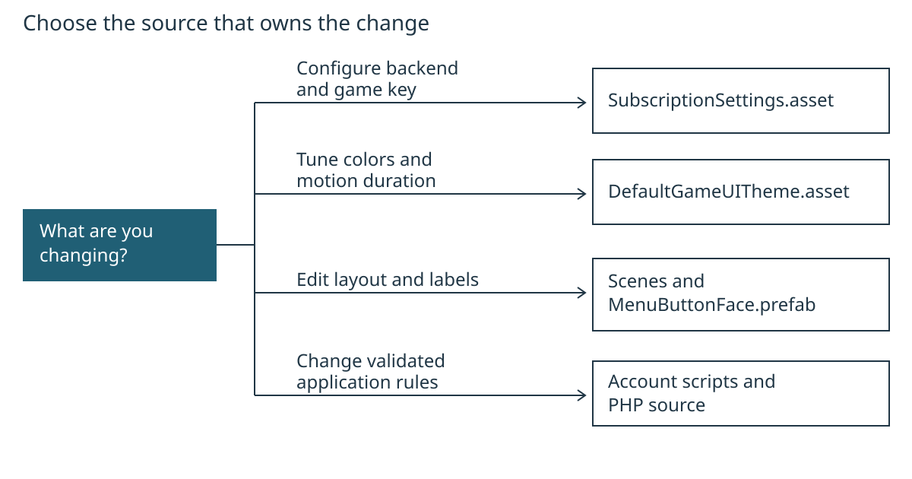

# Customize the account flow

Keep configuration in assets, state changes in `PlayerManager`, requests in `Player`, and display work in the existing controllers/loaders. Start with [setup](../SETUP.md) if the template is not configured. These examples assume Unity 2022.3.62f3 and the included PHP backend.

## Contents

- [Trace a request before editing it](#trace-a-request-before-editing-it)
- [Find the owner of a change](#find-the-owner-of-a-change)
- [Add a display-only account row](#add-a-display-only-account-row)
- [Adapt the phone policy on both sides](#adapt-the-phone-policy-on-both-sides)
- [Preserve the integration boundaries](#preserve-the-integration-boundaries)
- [Verify and export](#verify-and-export)

## Trace a request before editing it

`LoginController.LogMasuk()` validates input and starts its login coroutine. The controller constructs the original form fields, then calls `manager.Requests.Post`. In normal play this is the `Player` component, which joins the configured endpoint, sends the request and returns a `Player.Result`.

The controller checks the captured session generation before accepting a response. `PlayerManager.AcceptLogin` owns session credentials and account caches. `RefreshNow` fetches the current profile and subscription, then raises `StateChanged`. `loadDetails`, `loadSubscriptionDetails`, `loadNama` and `GameUIAccessSummary` subscribe while enabled and render that state. They do not independently grant access.

For billing, `LoadPaymentSite` asks `createBillingLink.php` for an authenticated ticket. The returned URL must match the configured HTTPS host and allowed page and must not be expired. Opening the browser sets up a refresh on return; it does not set premium status. See [the backend contract](../BACKEND_CONTRACT.md) for the wire rules.

The editing map routes common changes to their existing sources. It describes where to edit, not runtime dependencies. The [editable SVG](../diagrams/customization-map-r1.svg) preserves the four destinations in the [original Mermaid source](../diagrams/customization-map.mmd) and arranges them vertically for readable print labels.



## Find the owner of a change

| Existing file | Responsibility and safe editing point |
| --- | --- |
| `Assets/SubscriptionSettings.cs` and `Assets/Settings/SubscriptionSettings.asset` | URL, game key, endpoints, timing and configuration validation. Use the Inspector for installation values. |
| `Assets/Player.cs` | HTTP, credential attachment, response parsing and callback delivery. `IPlayerRequests` is the existing offline test seam. |
| `Assets/PlayerManager.cs` | Session generation, refresh state, explicit cache mappings, access decision and logout. |
| `Assets/LoginController.cs`, `Assets/RegisterUserController.cs` | Form validity, one submission at a time, response messages and retry. |
| `Assets/loadDetails.cs` | Profile rows and verification request ownership; `VerificationCooldownSeconds` controls the client resend delay. |
| `Assets/CheckEmailVerify.cs`, `Assets/checkEmailValidation.cs` | Whether verification or billing controls are currently usable. These are presentation guards; server authorization remains required. |
| `Assets/loadSubscriptionDetails.cs` | Plan/date/status rows; `StatusMessage` prioritizes failures over stale display state. |
| `Backend/SubscriptionServer/src/Accounts.php` | Registration policy, login, session conflict handling and verification/mail operations. |
| `Backend/SubscriptionServer/src/Core.php`, `Billing.php` | Server authentication/database boundaries and provider synchronization/checkout. |

The existing lower-case component names are retained because scenes and external code may reference them. Improve a local/private name when useful; do not rename public actions or serialized fields without a compatibility migration.

## Add a display-only account row

This example displays the current account ID; it adds no API field and does not make the profile editable. Work in a copy or branch, with Play mode stopped and scene edits saved.

1. Open `Assets/Scenes/LamanUtama.unity`. Find the profile panel's `loadDetails` component. Duplicate an existing read-only detail row in that panel and adjust its RectTransform to avoid overlap. Change its visible caption to `ID akaun`.
2. In `Assets/loadDetails.cs`, beside the other serialized input fields, add:

```csharp
[SerializeField]
TMP_InputField accountIdField;
```

3. In `LoadDetailsUser()`, immediately after the existing name/email/phone `Set` calls, add:

```csharp
Set(accountIdField, manager != null && manager.IsLoggedIn
    ? manager.id_user.ToString()
    : "");
```

4. Wait for compilation, then assign the duplicated row's TMP_InputField to Account Id Field on `loadDetails`. Keep it read-only; the existing `Set` helper also applies that property. Save the scene and run scene validation.
5. Use an authorized development account to inspect the row. Trigger refresh, close/reopen the profile, log out and sign in as another account. The row should show only the current signed-in account ID and clear when there is no session.

Do not use this ID to authenticate a request. The server validates the bearer session and rejects mismatched identity fields. A modified client can change its own UI. If you later display a new server property, update the wire contract, parsing, state mapping and tests together.

## Adapt the phone policy on both sides

The shipped policy accepts Malaysian mobile numbers through `RegisterUserController.MatchPhoneNumberPattern` and `registerAccount()` in server `src/Accounts.php`. Changing only Unity causes valid-looking forms to fail on the server.

For a concrete alternative, require a plus sign, a nonzero first digit and 7–15 digits total. This is a simple international-format policy, not a country-specific phone-number verifier. It requires no new package.

In `Assets/RegisterUserController.cs`, change the pattern to:

```csharp
public const string MatchPhoneNumberPattern = @"^\+[1-9][0-9]{6,14}$";
```

In `Backend/SubscriptionServer/src/Accounts.php`, change the `$validPhone` expression inside `registerAccount()` to:

```php
$validPhone = preg_match('/^\+[1-9][0-9]{6,14}$/', $phone);
```

Update the server's registration error text, SignUp's phone label/placeholder, and any tooltip to describe the same format. Keep the existing 30-byte server input cap. Before adopting this in an existing deployment, decide how to normalize stored phone numbers and retain uniqueness; this example does not migrate existing accounts.

| Input | Proposed rule |
| --- | --- |
| `+60123456789` | Accept |
| `+1234567` | Accept |
| `0123456789` | Reject: plus sign missing |
| `+01234567` | Reject: first digit is zero |
| `+123456` | Reject: fewer than seven digits |
| `+1234567890123456` | Reject: more than fifteen digits |

Update existing offline fixtures that use Malaysian numbers intentionally, then test accepted input, rejected input and duplicate phone registration against the same revised policy. The repository retains its Malaysian policy; this example is a customization recipe, not a shipped policy change.

## Preserve the integration boundaries

Keep session generation checks after asynchronous replies. `SessionVersion` changes when the account is cleared or its pending refresh is canceled. A late response or protected 401 from an old account must not affect the next account.

Keep `try/finally` cleanup around pending requests and release only the verification owner captured by that request. A closed panel must not leave a submit button locked or clear a newer request's state. Pair `StateChanged` subscriptions with unsubscriptions.

For PHP changes, preserve prepared SQL parameters, transaction scope, account lock order, single-use tokens and durable checkout idempotency. The account lock in `synchronize()` spans retrieval and application of provider state so a stale concurrent response cannot win. The checkout intent commits before a provider side effect so an interrupted call can reuse its key.

`PlayerPrefs` keeps legacy display keys. `ApplySubscription` now names each wire-field/cache-key mapping explicitly. Add a cache field only when needed, with its cleanup path and round-trip regression check. Do not persist bearer tokens or treat local caches as proof of payment.

## Verify and export

Run the scene validators and both offline suites using [setup's offline steps](../SETUP.md#confirm-the-template-works-offline). The data suite includes cache identifier mapping, display-field mapping and null-value replacement. Use the [server test procedure](../../Backend/SubscriptionServer/README.md#verification-and-release) after PHP policy or transaction changes. It requires a disposable localhost database and sends no live payment requests.

Validation evidence for this refactor is recorded in [VERIFICATION.md](../VERIFICATION.md#maintainability-refactor). Scripted customization checks and manual Editor steps are identified separately there. Hosted email, Stripe transactions, physical-device input and the complete human walkthrough remain owner checks.

Regenerate both screen HTML companions from the root:

```text
python Docs/tutorial/export_game_ui_tutorial.py
```

The screen exporter uses Python's standard library. To rebuild both PDFs and static print HTML, run:

```text
python Docs/tutorial/export_tutorial_pdfs.py
```

PDF export requires Python Playwright and installed Edge/Chrome. See [the menu tutorial's export steps](game-ui-customization.md#export-this-tutorial) for prerequisites and the editable print styles. Edit Markdown for content; HTML and PDF are generated outputs. Check code blocks, links, tables and page breaks after a change. The exporters reject unsupported Markdown or page overflow rather than silently dropping content.
