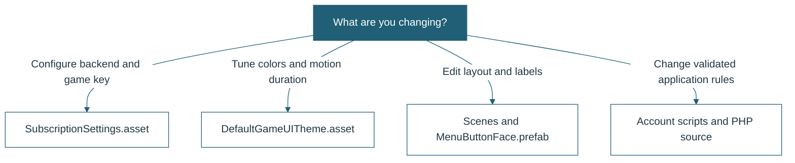

# Subscription Template Implementation Plans

The [maintainability and setup proposal](#make-the-template-easier-to-read-configure-and-customize) is the current plan, added 3 November 2026. The approved work is implemented; [fresh evidence and remaining manual checks](Docs/VERIFICATION.md#maintainability-refactor) are recorded separately. The earlier template work and UI revamp records remain below as history.

## Contents

- [Original template refactor](#refine-the-existing-subscription-project-into-a-reusable-template)
- [Game UI revamp and implementation record](#game-ui-revamp)
- [Maintainability and setup proposal](#make-the-template-easier-to-read-configure-and-customize)

# Refine the Existing Subscription Project into a Reusable Template

Status: Implemented in place. The original design below records the agreed scope. See README.md and Docs/SETUP.md for the implemented setup; Docs/VERIFICATION.md records checks and remaining device/backend validation.

## 1. Objective and boundaries

Improve this project in place so other developers can configure and reuse its existing account and subscription system. Keep its identity as your project: the existing screens, UI components, animations, navigation, and GPM payment integration remain the starting point.

The work will use:

- `Assets/Scenes/LogMasuk.unity` for registration and login.
- `Assets/Scenes/LamanUtama.unity` for the dashboard, profile, and subscription panels.
- The existing C# components, repaired and refactored in place.
- The current Unity UI/TextMesh Pro setup and GPM WebView plugin.

There will be no replacement scenes, new demonstration game, alternate UI framework, new bootstrap architecture, or archive of the original application. Additions must solve a concrete need in the existing project.

Keep the current Unity version, **2022.3.62f3**, and existing package choices. The version/package changes already present in the working tree are outside this task and must be preserved.

## 2. What the finished template should do

Another developer should be able to:

1. Open this same project and its existing login scene.
2. Set their backend URL and game/module identifier in one configuration asset.
3. Configure their subscription page paths, refresh interval, and request timeout.
4. Adjust the current UI text, logo/artwork, and colors using the existing scene objects.
5. Register, log in, verify email, view a subscription, manage billing, and log out through the existing screens.
6. Connect their own gameplay to a documented subscription-access check without needing a new example scene.
7. Follow a setup guide explaining the required PHP endpoints and expected responses.

Existing buttons should keep their purpose. Existing public methods used by scene events should remain available where practical. Where a binding must change, update and verify that binding in the current scene.

## 3. Findings to address

These findings come from the current client source. Backend behavior and device-specific problems require separate verification.

| Area | Current finding | Planned correction |
| --- | --- | --- |
| Domain configuration | `Domains.Awake()` overwrites the Inspector value with a fixed Hanana URL. | Read a shared configuration instead; remove the hardcoded production default. |
| Application identity | Multiple requests hardcode `Modul 2`. | Read one configurable game/module identifier while preserving the `_game_name` request field. |
| Session timing | `PlayerManager` starts requests, waits 0.2 seconds, then checks local values. | Make decisions after the relevant request actually completes. |
| Repeated components | Refresh and panel activation repeatedly call `AddComponent<Player>()`. | Reuse one initialized `Player` service component. |
| Concurrent requests | Four-second polling can overlap slow requests and panel refreshes. | Coordinate refreshes and prevent overlapping refresh operations. |
| Incorrect dates | `AssignInformation()` reads both dates from `stripe_id`. | Read `start_date` and `end_date` correctly. |
| Profile synchronization | `fetchUser()` does not consistently refresh the manager's cached profile values. | Apply successful profile responses to the shared state before updating UI. |
| Registration errors | The connection-error path does not reset `isLoading`. | Reset loading state and restore usable controls on every terminal path. |
| Runtime editor import | `LoginController` imports `UnityEditor`. | Remove unused editor-only dependencies from runtime scripts. |
| Logout cleanup | `SceneController` clears all PlayerPrefs immediately after starting remote logout. | Capture required identifiers first; clear only account/subscription keys and reset in-memory state. |
| Stale subscription data | Login fallback paths can set Trial without clearing a previous account's subscription identifiers/details. | Centralize account-specific cleanup and distinguish a confirmed missing subscription from a failed fetch. |
| Fragile UI references | Repeated `GameObject.Find` and child indices tie behavior to names and hierarchy order. | Populate serialized references on the existing components and scene objects. |
| Per-frame UI work | Profile, subscription, and verification UI polls values in `Update()`. | Update after data changes or panel activation. |
| Scene events | LamanUtama contains `Reassign` event entries whose target method needs checking. | Inspect each target; repair or remove invalid event entries in place. |
| Request/response handling | Responses use JSON mixed with literal status strings and lack consistent validation. | Handle known response forms explicitly, including empty, malformed, and unexpected responses. |
| Billing return | WebView callbacks mainly log events. | Refresh profile/subscription data after close or app resume, with a visible retry path. |
| URL parameters | Payment URLs concatenate account values directly. | Encode parameter values, normalize URL joining, and constrain page navigation to configured trusted destinations. |
| Logging | Some handlers log complete server responses containing user/subscription data. | Replace raw response logging with useful, non-sensitive diagnostics. |

Also inspect initialization order, duplicate persistent managers, disabled/destroyed objects receiving callbacks, button double-submission, validation behavior, and UI layout on the target resolutions. Report additional defects with evidence before choosing a fix.

## 4. Minimal additions

### Shared configuration

Add one small `SubscriptionSettings` ScriptableObject class and one shared asset. Reference that same asset from the existing `Domains` component in both scenes.

Proposed fields:

| Setting | Purpose |
| --- | --- |
| Backend base URL | Replaces the fixed Hanana domain |
| Game/module identifier | Replaces hardcoded `_game_name` values |
| Endpoint/page paths | Existing PHP route names, configurable for another deployment |
| Request timeout | Prevents an indefinitely pending request |
| Refresh interval | Controls the existing login/subscription polling behavior |
| Login/home scene references or names | Defaults to the two current scenes |
| Support/contact text | Optional value for existing help/notice UI |

Do not put Stripe secret keys, database passwords, or email credentials in Unity configuration. Leave the template URL unconfigured rather than shipping a live company's endpoint as the default.

Keep `Domains` as the existing configuration access point so current components do not need an unrelated service architecture. Consolidate the redundant registration-controller Domain setting so the Inspector does not present two competing configuration sources.

### Small validation utility

Add a lightweight editor validation command only if needed to check configuration, scene references, and button bindings. It should report actionable issues and select the relevant object/asset. It must not generate new scenes, replace the scene list, or silently rewrite Player Settings.

### Documentation and focused checks

Add a README/setup guide and focused tests for shared state, parsing, refresh sequencing, and cleanup. Keep supporting helpers small; first place request/state improvements in the existing `Player` and `PlayerManager` code.

Do not add a mock backend, reference PHP server, dependency injection framework, secure-storage package, new UI package, or native billing plugin as part of this refactor.

## 5. Changes to existing code

### Domains.cs

- Preserve the component and its scene/script GUID.
- Reference the shared settings asset and expose a validated base URL to existing callers.
- Normalize trailing slashes and validate configuration before sending requests.
- Handle duplicate instances and initialization order predictably.
- Show a useful setup error through the existing notice UI when configuration is missing; avoid null-reference failures or requests to an unintended URL.

### Player.cs

- Keep it responsible for the existing profile, subscription, and logout requests.
- Add completion/result reporting so callers can wait for outcomes instead of guessing timing.
- Use the configured game identifier, endpoint paths, and timeout.
- Separate successful data, confirmed no-result responses, connection failures, and invalid server responses.
- Validate parsed models before applying them; update all related state together.
- Reuse common response/cleanup code where it reduces duplication.
- Remove obsolete commented-out persistence experiments once active behavior is covered.
- Dispose requests and prevent outdated responses from being applied after logout or account switching.

### PlayerManager.cs

- Preserve the existing singleton component and its references.
- Maintain one reusable `Player` component.
- Coordinate startup, periodic refresh, panel refresh, and resume refresh.
- Refresh once at a time; do not queue unbounded duplicate refresh requests.
- Read correct PlayerPrefs keys and apply fresh state before publishing changes.
- Expose lightweight state-change notifications for the existing UI loaders.
- Clear both saved and in-memory account state on logout/session invalidation.
- Treat network failures as unavailable/stale data, not proof of logout or a free/trial subscription.
- Preserve the existing login/device policy until the PHP `login_logs` contract has been verified.
- Limit automatic redirects to authentication transitions. A future developer's gameplay scene must not be redirected to LamanUtama every polling cycle merely because its name differs.

### LoginController.cs and RegisterUserController.cs

- Preserve their existing scene components, animations, and button actions.
- Replace fragile object lookups with serialized references wired to the current hierarchy.
- Use consistent submission/loading/error handling, including retry after failures.
- Reject duplicate submissions while a request is in progress.
- Keep the current account fields, including phone number, and improve validation without silently changing the intended regional rules.
- Clear previous account data at the appropriate authentication boundary.
- Keep failed subscription retrieval distinguishable from successful authentication.
- Do not store passwords or print authentication responses.

### Existing UI loader/verification scripts

Update `loadDetails`, `loadNama`, `loadSubscriptionDetails`, `checkEmailValidation`, and `CheckEmailVerify` in place:

- Subscribe to manager state changes and unsubscribe when disabled/destroyed.
- Refresh when a panel opens without creating more service components.
- Render account, verification, plan, and date values only when state changes.
- Provide loading, unavailable, verified/unverified, subscribed/unsubscribed, and retry states using existing controls.
- Preserve the current visual layout and animations; repair specific overlap/scaling problems found during inspection.
- Avoid overwriting an actively edited input every frame.

### LoadPaymentSite.cs

- Retain GPM WebView for its supported target platforms.
- Use configured page paths and properly encoded query values.
- Disable actions when required account/subscription values are unavailable.
- Refresh state on close/resume, with bounded retry if the backend has not yet updated.
- Never grant access because a browser page closed or a return URL loaded.
- Explain unsupported Editor/platform behavior through the current notice panel. Add a system-browser fallback only where it is required and can be verified.

### SceneController.cs

- Keep the existing `Logout(string)` scene-event entry point where practical.
- Delegate to one coordinated logout operation.
- Capture server request data before clearing local state.
- Clear only this system's account/subscription keys, preserving unrelated game settings and progress.
- Return to LogMasuk and restore usable controls even if the server cannot be reached; report the remote failure clearly.

## 6. Existing scene changes

Edit only `LogMasuk.unity` and `LamanUtama.unity`:

1. Wire the shared configuration asset into their existing manager objects.
2. Assign explicit UI references to the current controllers/loaders.
3. Repair missing-script references and invalid UnityEvent targets found during inspection.
4. Keep login, registration, profile, subscription, verification, and logout panels in their current scenes.
5. Make existing headings, logos, and help text understandable as editable template content.
6. Preserve existing scene names, GUIDs, working animations, and navigation.
7. Correct demonstrable UI glitches at the intended resolutions, without replacing the design.

No wholesale scene regeneration, UI framework migration, or creation of Bootstrap/GameHub/demo scenes is planned.

## 7. Backend compatibility and access limitations

The repository does not contain the PHP backend. The refactor must document and preserve the current integration fields and routes where possible:

- `insertUser.php`
- `loginVerify.php`
- `getinfouser.php`
- `getinfo.php`
- `sendVerification.php`
- `logout.php`
- `pilihplan.php`, `tukarplan.php`, and `manageSub.php`

Write a contract table containing each method, input field, JSON shape, and known literal response. Verify the meaning and transition rules of `login_logs`; the current login and polling code interpret it differently at different stages, so its intended server behavior must not be guessed.

Client improvements cannot establish whether an ID/email-based endpoint authorizes users correctly. Keep subscription/UI flags as cached display state, and document that backend authorization and payment verification are required for protected server resources.

If a reliable/security-sensitive fix requires a backend change, identify the specific contract change and explain it separately. Do not silently introduce a replacement API or claim the existing backend is secure. External production endpoints and payment operations will not be exercised during ordinary local verification.

For integration with another game, provide a simple manager access method based on freshly fetched subscription state, with an explicit policy for unavailable/expired data. Explain that this is a client gameplay gate, not tamper-proof authorization. Document usage in code; do not create a gameplay scene.

## 8. Implementation order and acceptance checks

### Phase 1 — Establish a baseline

- Record current scene hierarchy, controller references, UnityEvents, build scenes, and working flows.
- Identify the correct connected Unity instance before editor operations.
- Record pre-existing working-tree changes and leave them untouched.
- List backend assumptions and currently reproducible bugs.

Acceptance: changes can be reviewed against the original two scenes; no unrelated Unity project or external service is modified.

### Phase 2 — Configuration and deterministic requests

- Add the one shared settings asset.
- Update existing request callers to use it.
- Fix singleton initialization, repeated Player components, request completion sequencing, and timeouts.
- Correct date mapping and centralize account/subscription cleanup.

Acceptance: no hardcoded Hanana URL or Modul 2 value remains in active request logic; one refresh does not overlap another or create more Player components.

### Phase 3 — Account/session bug fixes

- Repair registration/loading recovery, duplicate clicks, login result handling, logout, and stale-account isolation.
- Handle malformed/empty responses and network errors deliberately.
- Preserve unrelated PlayerPrefs and avoid stale callback updates.

Acceptance: a failed request does not trap controls, leak a previous account's details into the next account, or erase unrelated game preferences.

### Phase 4 — Existing UI and payment flow repairs

- Replace per-frame polling and fragile lookups in the current loaders/controllers.
- Repair existing scene bindings and verify animation/navigation behavior.
- Encode billing URLs and refresh after close/resume.
- Fix only observed layout/input glitches.

Acceptance: the same screens work through registration, profile, verification, subscription display, billing navigation, and logout; invalid scene events and avoidable null references are resolved.

### Phase 5 — Template documentation and verification

- Write the setup/customization walkthrough and backend contract.
- Add focused checks for the defects fixed.
- Test from the existing LogMasuk scene, including a clean build of the actual project when the appropriate editor/platform support is available.
- Report exactly what was tested and what still requires a real backend/device.

Acceptance: another developer can configure this project without searching through scripts for URLs or module names, while the original scenes and workflow remain recognizable.

## 9. Step-by-step setup guide to deliver

1. Open the project with the version recorded in `ProjectVersion.txt`.
2. Locate the shared SubscriptionSettings asset referenced by the existing Domains component.
3. Enter the backend base URL, game/module identifier, endpoint/page paths, timeout, and refresh interval.
4. Confirm the external backend implements the documented PHP contract; obtain/configure it separately if necessary.
5. Open LogMasuk and check configuration/references using the validation command, if included.
6. Edit the existing UI text, logos, and artwork to match the developer's game.
7. Enter Play mode and verify account registration/login using an authorized test backend.
8. Check verification and subscription details in LamanUtama.
9. Test billing pages on a supported device and confirm that returning refreshes server state.
10. Integrate the documented access check into the developer's own gameplay.
11. Configure company/package identifiers, icons, and signing in Player Settings.
12. Build and verify on the intended platform, including its applicable billing requirements.

The client-only repository cannot provide a complete connected registration/payment service without an external backend. The setup guide must state this prerequisite plainly.

## 10. Verification matrix

| Scenario | Expected result |
| --- | --- |
| Configuration missing | Actionable setup message; no request to a fixed production domain |
| Slow response | Loading remains accurate; decisions wait for completion |
| Repeated button clicks | One active submission/request |
| Registration connection error | Controls recover and retry is possible |
| Invalid/empty server response | Clear error; no partially applied profile/subscription |
| Periodic refresh while panel opens | Coordinated refresh; no accumulating Player components |
| Account A logs out, then B logs in | No account A details or subscription survives |
| Logout with game preferences present | Account data clears; unrelated preferences remain |
| Logout while requests are pending | Outdated callbacks cannot restore the previous account |
| Network failure during status check | No false successful verification or invented trial state |
| Verified email | Existing subscription controls update consistently |
| Billing URL with special characters | Values are encoded and reach the configured page correctly |
| Billing close/resume | Server state refreshes; page navigation alone grants nothing |
| External gameplay scene | Polling does not forcibly redirect an authenticated user to the dashboard |
| Normal scene transitions | One persistent manager/configuration instance |
| Target-device UI | Existing panels scroll/scale correctly and input remains usable |

Use focused automated tests for request coordination, response application, cleanup, URL construction, and lifecycle behavior. Use scene/device checks for wiring, animations, input, and WebView behavior. No real purchase is required for local code verification.

## 11. Definition of done

- The two original application scenes remain the active project scenes.
- Existing scripts/components are refactored rather than replaced by an independent starter project.
- Confirmed bugs are fixed with appropriate verification.
- A single configuration controls backend/application-specific values.
- Existing UI references/events work, with no repeated service-component creation or fixed-delay session decisions.
- Errors recover gracefully and account-specific state is isolated.
- Documentation explains setup, customization, gameplay integration, backend requirements, and remaining limitations.
- Pre-existing Unity/package changes and external production services are preserved.

Implementation was authorized and carried out within these boundaries: existing scripts and scenes were updated, with shared settings, editor validation/regression helpers, and documentation added. Package/editor-version changes that predated this work are preserved.

---

# Game UI Revamp

Status: **Implementation authorized and delivered locally on 3 November 2026.** See the implementation record below for completed work, verification and remaining acceptance checks. Original combined checklist items remain unchecked wherever they include unperformed manual/device checks.

## 1. Outcome and scope

Revamp the entire Unity account/subscription interface so it feels like a welcoming game menu: cohesive artwork, useful layout, a deliberate colour theme, responsive controls, and satisfying motion. Preserve registration, login, concurrent-device handling, profile display, email verification, subscription details, billing handoff, refresh, and logout.

The user requested an implementation Markdown first and explicitly asked not to execute yet. This phase therefore delivers a plan only. Implementation will edit the two existing scenes in place, preserving their identities and integration points.

Use the requested skills as complementary guidance:

| Skill | Application to this project |
| --- | --- |
| `game-ui-design` | Screen hierarchy, legibility, consistent controls and accessible states |
| `game-ui-ux` | Anchors, scaling, safe areas, focus, panel ownership and event-driven data |
| `game-feel` | Immediate input response and feedback proportional to the action |
| `game-designer` | Staging, easing and small amounts of follow-through |
| `no-slop-ui` | Remove redundant framing, generic grids, decorative copy and effects |
| `ui-unslop` | Audit the whole interface and verify the complete result |
| `avoid-ai-design` | Derive the theme from existing artwork; prevent drift between screens |

The explicit request for playful game motion takes precedence over the web-oriented skills' blanket restrictions on transforms and bounce. Small press/release effects are intentional here. Their SaaS sidebar and font prescriptions do not define this Unity menu.

## 2. Verified starting point

Repository inspection on 3 November 2026 established:

| Existing source | Consequence for the revamp |
| --- | --- |
| `ProjectSettings/ProjectVersion.txt`: Unity `2022.3.62f3` | Remain compatible with this editor; no Unity upgrade |
| `Packages/manifest.json`: uGUI `1.0.0`, TMP `3.0.7`; no Input System package listed | Keep uGUI/TMP and the existing input setup; no framework migration |
| `Assets/Scenes/LogMasuk.unity` | Entry, SignIn/SignUp, validation, notices and device-conflict flows stay here |
| `Assets/Scenes/LamanUtama.unity` | Home, profile, verification, subscription and billing actions stay here |
| CanvasScalers: both use 1920 × 1080; match values approximately 0.766 and 0.894 | Unify scaling deliberately, then verify at different aspect ratios |
| Scene events include `SetActive`, `Play`, `LogMasuk`, `DaftarPengguna`, `Logout`, `RequestRefresh`, `SendEmailToUser` and billing methods | Inventory bindings before changing hierarchy; replace conflicting visual events together |
| `LoginController.cs`, `RegisterUserController.cs` | Already own validation and pending requests; retain that ownership |
| `loadDetails.cs`, `loadSubscriptionDetails.cs`, `loadNama.cs`, verification loaders | Already consume manager state; extend presentation without another account service |
| `Assets/Animation/` | Contains notification, email, profile, loading and panel clips/controllers; audit their bindings before reuse |
| `Assets/Assets/1000ppi/` and `Assets/Assets/Profile/1000ppi/` | Existing illustrated backgrounds and state/action sprites provide the starting visual identity |
| `Assets/Editor/SubscriptionRegressionChecks.cs`, `SubscriptionPlayChecks.cs`, `SubscriptionTemplateTools.cs` | Reuse existing regression, scene-validation and build tooling |

The saved `Docs/SetupGuide/assets/login.png` and `dashboard.png` were visually inspected. They show illustrated rainbows/clouds/stars, a large template heading, widely separated entry actions, and a home screen with isolated bottom action icons. These are historical captures, not a fresh rendering of today's scenes. Their muted appearance is not sufficient evidence of a colour or overlay defect. Capture current views before implementation.

The working tree contains substantial earlier changes. Preserve them; do not reset, regenerate or replace the application. Historical passing tests in `Docs/VERIFICATION.md` are not verification of this future UI.

## 3. Art direction: a storybook game lobby

The interface should make the account feel like the player's place in the existing illustrated world, while keeping verification and paid access easy to understand.

Use the existing clouds, rainbow arcs, stars and butterflies as the world surrounding a clear menu. Give actions a tactile face and a shallow lower edge, like a game-menu button. Carry that one interaction detail across both scenes. Keep functional forms quiet enough to read.

This is a proposed direction, not an inferred brand requirement. A darker arcade treatment or a wooden fantasy treatment are possible alternatives, but both would require a larger change to the current illustration language. The storybook approach reuses the project's identity and avoids inventing a genre or gameplay loop.

### Proposed visual contract

| Role | Starting value | Use |
| --- | --- | --- |
| World background | `#DDEFF5` | Pale sky around the illustrated menu |
| Menu surface | `#FFFFFF` | Forms, details and modal content |
| Text/ink | `#203645` | Headings, labels, body and text on gold |
| Primary action | `#205F75` | Main action fill with white text |
| Highlight | `#F2BF50` | Selection marker and brief completion accent with dark ink |
| Success | `#276747` | Confirmed state icon/text on light surfaces |
| Error | `#A83242` | Error icon/text on light surfaces |

Colours are design inputs, not a claim of measured compliance. During implementation measure every actual text, control, focus and background combination: target at least 4.5:1 for normal text and 3:1 for large text and essential control boundaries. Use labels and shapes as well as colour. Do not use gold or pale sky as small text on white.

- Typography: use the existing LiberationSans SDF TMP asset if its referenced asset/glyphs are verified at the first slice. Headings 44–56, panel titles 32–40, body/input text 24–28, helper text at least 22 reference units at 1080p. Evaluate the effective on-screen size at the smallest viewport; allow scrolling/reflow instead of shrinking text indefinitely. No new font download is required.
- Layout rhythm: 8, 16, 24, 32 and 48 reference units. Use strong alignment and bounded text widths. Buttons at least 64 reference units high; check that effective touch targets remain at least 48 screen pixels on mobile.
- Shape: a small shared family of rounded buttons and panels, approximately 10 and 16 reference units respectively. Rounded forms follow the illustrated world; avoid nested rounded boxes around every row.
- Icons: reuse existing artwork where its meaning and resolution fit; pair navigation icons with visible labels. Keep Stripe attribution only where it describes a real billing destination.
- Surfaces: solid readable panels; no full-screen grey wash at rest, glass blur, neon outline system, gradient text or ornamental statistics. A dimmer belongs only behind an active modal.
- Language: preserve Malay as the primary UI language and make authored labels consistent. Do not change backend field values or status codes for localization. Billing actions must clearly state their actual destination/purpose.

These rules live in this plan until approved. During implementation record the final shared contract in `Docs/UI_DESIGN.md`; runtime theme assets hold the corresponding editable values.

## 4. Layout and screen changes

| Surface | Proposed composition and hierarchy | Behaviour to preserve |
| --- | --- | --- |
| Entry | Illustrated title area and one compact menu group. `Log masuk` is primary; `Daftar akaun` is secondary. Replace the oversized implementation-focused heading with an editable product/game title. | Existing login/registration panels; no pretend Play button leading nowhere |
| Sign in | Shared account panel with visible email/password labels, primary submit and clear Back action. Errors sit beside their field or persist in the form summary. | Input validation, password masking, duplicate-submit guard, session policy |
| Registration | Same panel family, ordered name/email/phone/password fields, scrollable body at small heights, fixed reachable action area. | Existing phone rules and all required fields; server response owns success |
| Device conflict | Focused confirmation explaining the other-device condition; explicit cancel/continue action labels. | Existing server-authorized logout flow; do not imply a cosmetic transition resolved it |
| Home/player lobby | Compact identity/status header. A prominent access summary with the next useful action; labelled Profile and Subscription menu entries form one anchored navigation group. Logout is separated as a secondary action. Artwork occupies the remaining space. | Real player name/access values; existing destinations and logout; no fabricated XP, currencies, quests or gameplay |
| Profile | Player identity followed by aligned account detail rows and a dedicated verification section. Keep immutable data visually distinct from editable form controls. | Current profile is read-only; no fake Save/Edit feature; verification and refresh remain functional |
| Subscription | One access panel: confirmed status first, plan and dates below, relevant subscribe/manage action, refresh/retry where needed. | Server-owned entitlements, stale/unavailable distinction, existing billing handoff |
| Email confirmation | Short explanation, visible state, resend action when allowed and Back/Close. | Actual cooldown, cancellation and verified-state behaviour |
| Pending, failure and success | Pending indicator belongs to its action; field errors remain near inputs. Blocking confirmations use one modal layer. Informational notifications are nonblocking. | Existing duplicate guards and request completion; no success before a real response |

For the first implementation pass, keep read-only `TMP_InputField` bindings where existing loaders depend on them and restyle them as detail rows with appropriate navigation. If replacing them with TMP labels improves usability, migrate the serialized field types, scene references and scene-check reflection together in the same slice. Never silently discard loader references.

### Responsive layout and input

- Keep 1920 × 1080 as the reference; start both CanvasScaler match values at 0.5 and tune only against the viewport matrix below. Use anchors and LayoutGroups, not a second set of hardcoded screen coordinates.
- Wide layouts place illustration beside the account panel. Narrow layouts keep one account panel and reduce/crop decorative art; lower-priority details scroll inside the panel. Use a small width-aware layout component only for the actual composition switch.
- Place essential content under a safe-area RectTransform. Background art may bleed beyond it. Reapply layout when resolution/safe area changes.
- Preserve the existing EventSystem/input module. Define initial focus, explicit traversal where required, Submit and Back. Validate keyboard and legacy gamepad mappings before promising controller support; do not add an input package to solve a visual change.
- Only the top modal captures input. On close restore the previous valid selected control; hidden panels cannot receive clicks. Back dismisses an overlay before changing the underlying screen and does not unexpectedly log out.
- Text entry consumes its navigation keys appropriately. Test the on-screen keyboard and scroll focused fields above it on mobile; desktop inspection cannot verify that behaviour.
- Add reachable `Kurangkan animasi` and UI sound controls in a small preferences panel. Preserve these preferences on account logout.

## 5. Motion and feedback contract

Values below are proposed defaults. Animate a visual child beneath a stable layout/hit-target root, using unscaled time. No response should wait for an animation before starting the requested action.

| Event | Proposed feedback | Constraint |
| --- | --- | --- |
| Hover / keyboard selection | Colour/edge change over 80–120 ms; stable visible selection marker | Same information for focus and pointer; no control moves away from the pointer |
| Button press | Visual face compresses to 0.97 scale and lowers 2 reference units over 50–70 ms | Hit target stays fixed; disabled controls do not play success feedback |
| Button release | Return over 100–140 ms; optional very small overshoot on major primary actions only | Cancel/reset on disable, pointer exit or interruption |
| Panel open | 180–220 ms ease-out, opacity and up to 16 units of travel | Animate content wrapper, not layout-owned geometry; focus/input state changes immediately |
| Panel close / Back | 120–160 ms ease-in | Immediately stop accepting input on the outgoing panel |
| Loading | Existing spinner adapted to shared styling | Only while a real operation is pending; text explains what is pending; no invented percent |
| Confirmed registration / verification | One 200–280 ms icon settle and brief highlight | Fire once per actual state transition, not each periodic refresh |
| Validation/server failure | Persistent message and field/error marker | No screen shake, flash, time freeze or celebratory response |
| Idle world | One subtle cloud/star movement outside the form, roughly 6–10 seconds per cycle | Low amplitude, only while visible; no text motion or perpetual attention pulse |

Reduced motion removes travel, scaling, overshoot and ambient motion; retain immediate state changes and optional short opacity fades. Provide a static pending symbol plus text when spinner rotation is disabled. Sound remains optional and independent, with a quiet click and a distinct completion cue only if suitable owned clips are available or authored. Do not repurpose the trailer score as a looping UI sound or download an audio pack without a reason.

Before altering `Assets/Animation/`, inventory which clips animate which properties. Reuse appropriate existing clips; remove conflicting direct `Animator.Play`/`SetActive` visual bindings only after their replacement is wired. One animation system owns a given property. Rapid open/close, scene changes and object disable must settle scale, opacity, raycast blocking and focus predictably.

## 6. Proposed source and editing points

These new paths are proposals, not existing implemented files. Add only the components needed by the approved slices.

| Location | Responsibility / human editing point |
| --- | --- |
| Existing two scenes | Editable layout, anchors, content, navigation and scene-specific references |
| `Assets/UI/Prefabs/` | Reusable Button, AccountPanel, DetailRow and Notice visual prefabs; keep scene-bound account controllers outside shared visual assets |
| `Assets/UI/Art/` | Any new owned supporting sprites with editable source where available; existing flattened PNGs remain flattened originals |
| `Assets/UI/Scripts/GameUITheme.cs` and `Assets/UI/Settings/DefaultGameUITheme.asset` | ScriptableObject values for colour roles, TMP fonts, shared type sizes and spacing |
| `Assets/UI/Scripts/GameUIThemeBinding.cs` | Apply named theme roles to assigned Graphics/TMP components in edit/Play mode; no hierarchy-name searches or destructive automatic scene generation |
| `Assets/UI/Scripts/GameUIButtonFeedback.cs` | Pointer/focus/press presentation on a serialized visual target; reuse Button.interactable and onClick |
| `Assets/UI/Scripts/GameUIPanelFlow.cs` | Visual panel transitions, modal ordering and focus restoration within each scene; no account state ownership |
| `Assets/UI/Scripts/GameUIPreferences.cs` | Reduced-motion and sound preferences under distinct UI preference keys; apply to currently open UI |
| `Assets/UI/Scripts/GameUISafeArea.cs` | Safe-area anchors and resolution-change handling |
| Existing controllers/loaders and `LoadPaymentSite.cs` | Limited presentation integration; retain requests, guards and server-owned state |
| `Assets/Editor/SubscriptionPlayChecks.cs` and `SubscriptionTemplateTools.cs` | Extend existing checks for revised references and meaningful flow regressions |
| `Docs/UI_DESIGN.md` | Final shared visual/motion contract and reasons for its choices |
| `docs/tutorial/game-ui-customization.md` | Future practical tutorial: editing the theme, prefabs, text, artwork, motion, references and verification |

Use serialized references with headers/tooltips and safe default settings. Keep mutable user preferences separate from shared theme configuration. UI art and layout remain editable without running a generator. Do not create overlapping UI service managers or rebuild either scene at runtime.

## 7. Implementation sequence and verification

Execute in order after approval. Each slice ends in a usable state; preserve a baseline diff/snapshot of the current uncommitted work before editing. Do not rely on the repository HEAD alone as rollback material.

### Slice 1 — Establish the theme on the real entry/login screen

- [ ] Capture the current entry, forms, home, details and overlay states; inventory serialized references, font assets, animation ownership and UnityEvents in both scenes.
- [ ] Add the shared theme, visual button/account-panel prefabs and preferences needed for this screen. Revamp the existing entry and login panel in `LogMasuk.unity`.
- [ ] Implement immediate pointer/focus/press feedback, safe-area layout, reduced motion and short panel transitions.
- [ ] Verify empty/invalid/valid login, pending/error, duplicate submission, keyboard Back and rapid panel switching. Capture at 1920 × 1080 and 1280 × 720; no clipped labels, dead clicks, lost focus or false success.

### Slice 2 — Complete registration and account overlays

Depends on slice 1.

- [ ] Apply the same prefabs/theme to registration, field warnings, email notice and device-conflict confirmation in `LogMasuk.unity`.
- [ ] Integrate presentation changes in `LoginController.cs` and `RegisterUserController.cs`; keep validation/request ownership. Replace auto-dismissed actionable errors with persistent inline/summary feedback.
- [ ] Verify all required fields, long names/email, invalid phone, duplicate email/phone, failed registration followed by retry, conflict cancellation, modal focus restoration and one request per submit. Narrow/short forms scroll without hiding the focused field or action.

### Slice 3 — Recompose the home and profile screens

Depends on slice 1; run alongside the completed account flows for regression checks.

- [ ] Revamp `LamanUtama.unity` with the lobby composition, shared labelled navigation and separate logout action.
- [ ] Restyle profile rows and verification controls, integrating `loadNama.cs`, `loadDetails.cs`, `checkEmailValidation.cs` and `CheckEmailVerify.cs` where their current responsibilities require it.
- [ ] Wire panel flow/focus once; remove replaced duplicate visual events. Keep updates driven by `PlayerManager.StateChanged`.
- [ ] Verify verified/unverified/unavailable profile, resend cooldown, close while verification is pending, long content, logout cleanup and preference preservation. Home has no disconnected gameplay action or fabricated data.

### Slice 4 — Finish subscription and billing presentation

Depends on slice 3.

- [ ] Revamp subscription details and access summary in `LamanUtama.unity`; integrate `loadSubscriptionDetails.cs` and the presentation boundary in `LoadPaymentSite.cs`.
- [ ] Present confirmed access, confirmed no access, refreshing, stale/unavailable and request failure distinctly. Display the actual plan/dates and only meaningful actions.
- [ ] Verify local offline fixtures for those states, verification-gated actions, double-click billing and return/resume refresh. Browser close never plays an access-granted effect on its own. Record real WebView/device checks separately when available.

### Slice 5 — Responsive, interaction and ownership review

Depends on slices 2–4.

- [ ] Validate all panels at 1920 × 1080, 1280 × 720, 1024 × 768, 2560 × 1080 and a narrow 720 × 1280 viewport. Portrait is a robustness target, not a promised new platform release. Use Device Simulator for safe-area previews where available and report its limits.
- [ ] Verify mouse, keyboard and available gamepad input; test selected disabled controls, modal stacking, interrupted transitions, scene exit during feedback, text expansion and no decorative raycast blockers. Test mobile keyboard on a real supported device before marking it verified.
- [ ] Measure contrast and effective text/touch sizes; visually compare matching before/after views for every screen. Check reduced motion both on entry and while a transition is active; confirm sound mute and preference persistence.
- [ ] Run `Tools > Subscription System > Validate Current Scene` for both scenes, then `Run Offline Regression Checks` and `Run Offline Scene Checks` outside Play mode, with saved scenes and the required empty template backend URL. Expected: no broken references/events, preserved account isolation/guards and passing existing checks. The intentionally unconfigured backend remains a documented setup condition.
- [ ] Extend meaningful checks for focus restoration, hidden-panel raycast blocking and interrupted transitions. Adjust tests tied to old hierarchy/field types to verify the same behaviour; do not remove account/security assertions to make the redesigned scene pass.
- [ ] Run the existing `SubscriptionTemplateTools.BuildWindowsValidation()` build helper through the established Unity tooling. Require a successful build and investigate errors/warnings. Do not overwrite unrelated historical publish output.
- [ ] Update `Docs/SETUP.md`, `Docs/VERIFICATION.md` and relevant README links; add `Docs/UI_DESIGN.md` and the customization tutorial. Link existing backend instructions rather than duplicate them. Update `PROJECT_STATE.md` to reflect approved scope and actual results.
- [ ] Demonstrate a representative customization: change the primary colour in the theme, edit the login label in its source prefab/scene, and tune button feedback in the Inspector; confirm both scenes still render and behave correctly. Document precisely which steps were performed.
- [ ] Provide a lightweight readable HTML tutorial companion, or PDF using existing practical tooling; keep it alongside the Markdown and inspect the export. Existing setup-guide screenshots/PDF and trailer then depict the old UI: mark them historical or update relevant guide captures/exports; a new trailer is outside this phase.

## 8. Boundaries, risks and recovery

- This phase changes the Unity presentation, not the PHP backend, Stripe-hosted checkout/Portal, subscription products/prices, authentication rules, access policy or gameplay. Custom backend browser pages can be a separate scoped design task.
- No new scenes, framework migration, tween dependency, package update or speculative game systems. Existing Unity animation/coroutine facilities are sufficient for the proposed effects.
- Navigation currently relies partly on scene UnityEvents. Changing hierarchy without reviewing these events can break flows even when scripts compile. Assign/validate serialized references in each slice and keep existing public action entry points where possible.
- Existing animation clips may target old paths or compete with new transitions. Inspect their curves and migrate them together with the relevant panel; never leave both writing the same property.
- New theme values may not suit every illustration or display. Contrast measurements, reference-size checks and real-device tests determine final adjustments.
- Roll back only the revamp's edits using the pre-implementation snapshot/diff. Keep earlier backend/template work and user changes intact. No destructive cleanup, blanket reset or checkout of the dirty working tree.

## 9. Acceptance and present verification limits

Implementation is complete only when all in-scope surfaces share the chosen theme, every existing account/billing action remains usable, focus and responsive layout pass the documented matrix, feedback can be interrupted safely, reduced motion works, and a human can edit the result through standard Unity assets and Inspector controls. The tutorial must match the finished files and distinguish executed checks from unperformed device workflows.

The initial planning pass performed source and historical screenshot inspection only. The user subsequently authorized implementation. Current results are recorded below.

## 10. Implementation record — 3 November 2026

- [x] Both original scene identities and existing controller/action bindings preserved. Entry, login, registration, device conflict, home, profile, subscription and logout confirmation layouts revised in place.
- [x] Shared theme asset and MenuButtonFace prefab, persistent motion preference, safe-area wrapper, panel fade/scale, focus/Tab/Back handling, button feedback and decorative drift added under Assets/UI.
- [x] Home access summary subscribes to the existing manager. Explicit refresh controls use RequestRefresh. Registration/email responses are inline; actionable failures persist with retry/Back reachable.
- [x] Scene validation found no missing references/events; both scenes report only the intentionally empty backend URL. Offline checks: 24 data assertions and 30 scene assertions passed. Windows validation build: Succeeded, errors=0, warnings=0.
- [x] Main screens/panels rendered across the five planned viewports. Actual image captures and a contact sheet were inspected. Shared color customization was applied programmatically to loaded bindings and restored.
- [x] Editable customization tutorial and standard-library HTML exporter delivered in Docs/tutorial; HTML export rendered and inspected. Docs/UI_DESIGN.md records the implemented contract.
- [ ] Real gamepad, touch keyboard, physical-device safe area, mobile WebView and live email/Stripe checks remain unperformed. Manual keyboard traversal and pointer feel still warrant human review; automated focus and transition checks are narrower evidence.

Implementation choices: bounded anchor-based panels fit the tested matrix, so no separate portrait composition or ScrollRect was introduced. One shared button-face prefab is reused; account panels/detail rows remain editable scene objects to preserve their existing loader bindings. Existing request/loading ownership remains with the original controllers. No sound cues, audio preference, success-confetti system, new font, package or framework was added. The default title is editable scene text; it is not a fabricated game mechanic.

Measured contrast ratios: white/primary 7.11:1, ink/field 11.13:1, ink/white 12.54:1, error/white 6.56:1, gold/primary 4.18:1. Secondary focus uses dark ink. Device-effective touch sizes and screen-reader support are not certified. The older PDF guide and trailer remain historical UI references; backend setup instructions still apply.

# Make the template easier to read, configure and customize

Status: implemented after user approval, 3 November 2026. The original proposal below records the chosen scope. Source changes, fresh checks and unperformed manual/device workflows are recorded in [the verification record](Docs/VERIFICATION.md#maintainability-refactor). Scene/prefab/settings values and package versions remain unchanged.

Keep the current game-menu appearance and account behavior. A developer should be able to configure the backend, change a label or theme value, understand an account request, and extend a rule using ordinary Unity and PHP tools. A wholesale rewrite would put working scene bindings and security checks at risk without a demonstrated benefit.

## Navigate this proposal

- [Evidence and editing points](#evidence-and-editing-points)
- [Compatibility and design decisions](#compatibility-and-design-decisions)
- [Implementation slices](#implementation-slices)
- [Verification and acceptance](#verification-and-acceptance)
- [Planning evidence and next action](#planning-evidence-and-next-action)

## Evidence and editing points

These findings come from the current checkout, including the files below. They are reasons for focused work, not claims that the system is broken.

| Existing source | Observed friction | Proposed outcome |
| --- | --- | --- |
| `Assets/PlayerManager.cs` | Login, refresh, logout and cache transitions often combine mutations on one line; cache keys and values depend on matching array order. | Make state transitions and persistence mapping readable while retaining the manager as the single owner of account state. |
| `Assets/Player.cs`, `Assets/SubscriptionSettings.cs`, `Assets/LoadPaymentSite.cs` | Request setup, validation, credential selection and billing guards are compressed. | Use named conditions and focused private helpers where they clarify real boundaries; keep the request interface and public actions. |
| `Assets/LoginController.cs`, `Assets/RegisterUserController.cs` | Long form-validity expressions; registration notice states use integers; request and response presentation are interleaved. | Make validation, submission, response handling and presentation easy to find within each existing controller. |
| `Assets/loadDetails.cs`, `Assets/loadSubscriptionDetails.cs`, `Assets/loadNama.cs`, `Assets/CheckEmailVerify.cs`, `Assets/checkEmailValidation.cs` | Dense lifecycle/render methods and nested status conditions obscure event subscriptions, freshness and verification ownership. | Expand lifecycle methods and use descriptive local decisions without adding competing state owners. |
| `Assets/UI/Scripts/GameUITheme.cs`, `GameUIThemeBinding.cs`, `GameUIAccessSummary.cs` | Theme fields lack Inspector guidance; chained ternaries hide role/status selection. | Document Inspector roles, use explicit selection branches, and make loaded-object theme application understandable. |
| `Assets/UI/Scripts/GameUIPanelFlow.cs`, `GameUIButtonFeedback.cs` | Focus setup, input and motion share dense methods; focusable controls are discovered dynamically. | Name the separate responsibilities and cache only stable component references; preserve dynamic interactability and focus order. |
| `Backend/SubscriptionServer/src/Accounts.php`, `Core.php`, `Billing.php` | Compact statements make authentication checks, transactions and provider operations harder to inspect. | Expand the affected functions in place; keep transaction, locking and idempotency boundaries visible. |
| `Docs/SETUP.md` | Says the backend is absent, describes identity-based payment URLs, and says result notices disappear after four seconds. These conflict with the included backend, ticket handoff and persistent form responses. | Correct the source instructions and link the current backend contract and customization guide. |
| `README.md`, `Backend/SubscriptionServer/README.md`, `Docs/tutorial/game-ui-customization.md` | Setup details are spread across references; some entry points lead with the historical PDF. | Establish one starting path and distinguish current operational instructions from historical screenshots. |
| `Docs/tutorial/export_game_ui_tutorial.py` | Exporter targets one tutorial and recognizes only a small Markdown subset. | Reuse or minimally extend it for the finished tutorial; support the constructs actually used and report unsupported ones. |

### Choose the file before changing a feature

Figure 1 shows the proposed editing workflow. The destinations already exist; the figure does not propose new runtime services. Source: the current settings/theme scripts, scenes and controllers inspected for this plan. The editable standalone source is [customization-map.mmd](Docs/diagrams/customization-map.mmd).

## Compatibility and design decisions

Preserve script `.meta` GUIDs, scene identities, serialized names/types, theme-role enum numeric values and public UnityEvent methods, including `LogMasuk`, `DaftarPengguna`, `Reassign` and payment actions. Keep the existing lower-case component names during this pass; a naming-only file migration offers little benefit beside the risk to bindings and external callers. If a serialized rename becomes necessary, use `FormerlySerializedAs`, validate both scenes and prefab overrides, and document the migration. Avoid changing public fields to private fields merely for style because external consumers may use them.

`PlayerManager` continues to own session/account state. `Player` performs requests and parses results. Controllers submit user actions; loaders and UI scripts present state. Keep `IPlayerRequests`, `StateChanged`, session-version checks, coroutine cleanup, callback order, credential capture during logout and bounded billing refreshes intact. Expand complex code before extracting it. Add a helper only when its name explains a real operation or removes meaningful duplication; no general service framework, event-bus replacement or dependency injection layer is planned.

Retain Malay user-facing copy and existing API/JSON names. Improve internal local/private names without translating backend keys or silently changing labels, validation policy, password rules, date semantics or entitlement conditions. A phone-policy change in the tutorial must cover both client and server, with tests, rather than suggest bypassing server validation. Keep secrets in private server configuration and credentials out of client assets/logs.

### Preserve the visual contract and clarify its controls

Use the `inside-design-system` audit profile from avoid-ai-design. The current illustrated menus already have a documented direction in `Docs/UI_DESIGN.md`; this is a maintainability pass, not another redesign. ux-color applies to role ownership, accessible customization and documentation examples.

| Current role | Source value | Plan |
| --- | --- | --- |
| Ink | `#203645` | Keep readable body text and secondary-control focus. |
| Primary | `#205F75` | Keep the main action color paired with white text. |
| Surface / field | `#FFFFFF` / `#EAF3F6` | Keep forms quiet and readable over the illustrated background. |
| Highlight | `#F2BF50` | Keep focus feedback; do not use it as small text on teal. |
| Error | `#A83242` | Keep error text paired with a meaningful message. |

These roles are existing `GameUITheme` fields. Add headers/tooltips and explain their consumers before adding settings. Keep colors centralized in the shared asset and use scene overrides for action-specific labels. Do not introduce a second palette asset, new dark mode, font migration or arbitrary success/warning colors. Add a semantic role only if an actual uncovered state requires it, assigning a new enum value without shifting old values. Pale form surfaces should dominate functional UI; the illustrated background is not subject to a mechanical area quota.

The HTML scanner reported one K7 P1 heuristic: no explicit `:focus-visible` rule in the current tutorial export. This establishes missing authored focus styling, not that browser-native focus is invisible. Check actual keyboard navigation and add a clear focus style in the exporter if needed. No HTML scanner result certifies Unity scenes. Current visual judgments are based on source and the existing design record, not fresh scene renders. Keep visual changes surgical; a theme-only cleanup or an entirely new visual direction would not improve the requested code readability.

## Implementation slices

The implementation tasks below are complete. Expected verification describes the intended checks; the linked verification record identifies what ran and which manual/device checks remain open.

### Slice 1: preserve a baseline and prove one readable customization

Locations: `Assets/UI/Scripts/GameUITheme.cs`, `GameUIThemeBinding.cs`, `GameUIAccessSummary.cs`; `Docs/tutorial/game-ui-customization.md`.

- [x] Snapshot the current dirty working tree outside generated build output, including untracked application/backend/docs files. Inventory scene/prefab references and public entry points before edits; a clean HEAD is not a sufficient rollback baseline here.
- [x] Run the existing data checks, scene checks and both scene validators with saved scenes and the template backend URL empty. Record the actual results before refactoring.
- [x] Expand theme/status selection into readable methods, keep existing serialized fields/enum values, add concise Inspector tooltips, and describe theme edit-mode application scope. Do not introduce new user-facing state rules.
- [x] Update the tutorial's first customization to name the theme, a label override and the feedback duration. Verify changing Primary in both scenes, then restore example changes. Check the color pair as well as the visual effect.

Expected verification: both original scenes retain references and button actions; all existing theme roles render the same colors; refresh/unavailable/active/no-access summaries preserve their current precedence; customization changes reach the intended objects. This is the smallest complete source-plus-documentation slice.

### Slice 2: make forms, verification and menu interactions traceable

Depends on slice 1. Locations: the existing login/registration controllers, loaders, verification controls and `Assets/UI/Scripts/` components listed above.

- [x] Expand grouped declarations and multi-operation lifecycle methods where they hide intent. Name form readiness, notice state and status decisions; replace private integer notice codes with a local named enum without touching serialized event signatures.
- [x] Make verification ownership, cooldown release and subscribe/unsubscribe pairs easy to inspect. Keep account state in the manager and keep late-response protection intact.
- [x] Separate panel focus setup, Tab/Back handling and transition calculations into private methods within the existing component. Cache stable `Button`/`Outline`/binding references where appropriate, while still evaluating live control availability. Preserve reduced motion, fixed hit areas and interrupted transitions.
- [x] Keep labels editable in scenes/prefabs. Move repeated presentation text into a shared source only if inspection shows a real shared editing need; do not create a localization system or expose every message as an Inspector field.

Expected verification: one submit produces one request; retry remains possible after failure; closing forms cleans up listeners/coroutines; verification cooldown and account-switch guards survive; disabled controls are skipped during navigation; reduced motion and focus restoration behave as before. Capture matching scenes to check unintended visual changes.

### Slice 3: clarify session, request and billing code without changing policy

Depends on slice 2. Locations: `Assets/PlayerManager.cs`, `Player.cs`, `SubscriptionSettings.cs`, `LoadPaymentSite.cs`.

- [x] Expand request configuration, response parsing and access guards into readable blocks with descriptive locals. Comment on session versions, fresh-state access denial, logout credential capture and return/resume refresh where the reason is not obvious.
- [x] Replace fragile parallel cache-value mapping with an explicit, auditable mapping in the existing owner. Preserve every preference key, default, cleanup rule and notification order. Do not add a cache manager.
- [x] Extract private request-form or cache helpers only where the resulting sequence remains easier to trace. Keep coroutine `try/finally` cleanup and manager lifetime behavior unchanged.
- [x] Make billing action selection and ticket URL/expiry validation readable. Retain existing public action methods, mobile GPM WebView, desktop browser behavior and server-confirmed access policy.

Expected verification: stale replies and obsolete 401s cannot clear/restore the wrong session; access fails closed for unavailable/expired state; logout preserves unrelated preferences and still sends captured credentials; request redirects remain disabled; untrusted/expired billing URLs are rejected. Test cache round trips against expected field values to catch mapping swaps.

### Slice 4: make the included PHP boundaries readable

Depends on slice 3. Locations: `Backend/SubscriptionServer/src/Accounts.php`, `Core.php`, `Billing.php`, plus directly affected tests in `tests/`.

- [x] Reformat dense functions into explicit blocks and descriptive locals. Separate formatting edits from any helper extraction so reviewers can compare transaction bodies and security checks.
- [x] Retain route/function contracts, HTTP statuses, response bodies, SQL parameters, lock ordering, transaction scope, single-use token checks and provider idempotency keys. Keep account locking across provider synchronization where the existing code requires it.
- [x] Add short comments explaining non-obvious concurrency/recovery boundaries. Do not split every function into a new class or move shared public entrypoints for naming consistency.
- [x] Run PHP lint and the existing isolated backend suite. If local PHP/database prerequisites are absent, record this slice as unverified and do not declare server refactoring complete on formatting inspection alone.

Expected verification: existing authentication, cross-account ownership, concurrent login, ticket replay/CSRF, interrupted checkout, stale webhook and provider-failure cases still pass. No database schema, endpoint, SDK, worker cadence or deployed service change is proposed.

### Slice 5: rebuild the setup path around the maintained sources

Depends on slices 1–4. Locations: `README.md`, `Docs/SETUP.md`, `Docs/BACKEND_CONTRACT.md`, `Docs/UI_DESIGN.md`, `Docs/VERIFICATION.md`, backend README, existing tutorial/exporter, `PROJECT_STATE.md`.

Rewrite the setup path in this order: prerequisites; private server configuration and catalog; database migration/seed; health/config checks and workers; Unity settings and matching game key; offline checks; authorized online account/email/billing checks; build and device validation. Keep command details in the backend README and link them from Unity setup. Health status must not imply working database, email or billing integration.

- [x] Make README the starting point with links for setup, visual customization and code responsibilities. Replace stale backend/payment/notice descriptions and historical-PDF-first instructions. Preserve historical verification with dates instead of presenting it as a fresh run.
- [x] Add navigation and a concise troubleshooting table to setup: empty URL, mismatched game key, protected 401, absent mail/worker, stale subscription, broken reference and blocked clicks. Each entry names the check and owning file/tool.
- [x] Update `Docs/tutorial/game-ui-customization.md` rather than duplicate it. Add one companion tutorial, proposed `Docs/tutorial/account-flow-customization.md`, for request/state ownership and safe rule customization. Link setup and backend contract instead of copying them.
- [x] Include worked examples: change Primary with contrast verification; change one scene label without renaming every prefab instance; tune feedback duration; add a display-only profile row bound to existing state; adapt phone policy in both client and server. Label any unperformed example as untested.
- [x] Keep editable Markdown beside readable HTML companions. Minimally extend the existing exporter to accept the required sources and faithfully render fenced code, headings, links, lists and tables; do not silently turn examples into prose. Add visible link focus styling and check mobile overflow. Prefer HTML using current tooling; a new PDF toolchain and a full historical PDF/trailer rebuild are outside this pass.
- [x] Put a short source/responsibility/customization/verification index in setup. Label migration helpers such as `GameUIRevampTools.Apply` as one-time tooling; ordinary customization must not regenerate scenes. Update project state only with actual results.

Expected verification: a reader can follow one starting path, find the real asset/script, make a representative edit, rebuild and identify the right test without guessing. Check links and source paths, render the HTML at desktop and narrow widths, inspect its code samples/tables/focus, and verify exported text against Markdown. Source documentation remains authoritative.

## Verification and acceptance

| Check after implementation | Procedure and expected result |
| --- | --- |
| Unity compilation and references | Open in the recorded Unity 2022.3.62f3 editor; validate both scenes through `Tools > Subscription System > Validate Current Scene`. No missing scripts/references or invalid persistent actions; an intentionally empty URL remains a setup condition. |
| Account/state regressions | Run `Run Offline Regression Checks`, then `Run Offline Scene Checks`, with saved scenes outside Play mode and an empty template URL. All existing assertions pass; preserve their meaning. Add focused cases for changed branches/cache mapping where coverage is absent, not tests that mirror formatting. |
| Build | Invoke the existing `SubscriptionTemplateTools.BuildWindowsValidation()` through supported Unity tooling. Require a successful Windows build and investigate errors/warnings; preserve historical Publish artifacts. |
| Backend regressions | From `Backend/SubscriptionServer`, lint changed PHP files and use `composer test` / `php tests/run.php` with `APP_ENV=test`, localhost `DB_HOST` and disposable CREATE/DROP database credentials as documented. All existing assertions pass. Use no production database. |
| Public/serialized compatibility | Compare GUIDs, public action signatures, serialized fields/enum values, scene references and prefab overrides against the captured baseline. Any necessary migration is explicit and tested. |
| Human customization | Perform and restore the documented theme/label/timing edits and the display-row example. Verify the phone-policy example on both sides with accepted/rejected fixtures if implemented. Record exactly which manual steps ran. |
| Color and interaction | Recalculate changed text/background pairs: normal text at least 4.5:1, large text and necessary UI indicators at least 3:1. Preserve text feedback for status; compare the five existing viewport targets and test keyboard, pointer and reduced motion. Real gamepad/mobile checks remain separate. |
| Documentation/export | Verify relative links, heading anchors, commands, file paths, source/export agreement, code formatting and HTML keyboard navigation. Run the design scanner on exported HTML and review actual rendered output; its heuristics are not a substitute for inspection. |

Completion requires readable ownership and working human editing paths as well as passing checks. Review whether a new maintainer can follow login to request to state to presentation, locate common settings, and make the documented edits without AI. Keep the final report concise: changed sources, configuration entry points, actual verification and remaining limitations.

Recovery: revert only the approved slice against the pre-edit snapshot/diff, including its documentation and serialized assets if changed. Do not reset the entire dirty tree, regenerate customized scenes or delete unrelated work. No package installation/update, production deployment, live transaction, schema migration execution or new scene architecture is authorized by this planning request.

## Planning evidence and next action

Inspected the current client/state/controllers, UI/theme scripts, selected backend account/core/billing functions, setup/backend references, tutorial exporter, project version and existing verification records. The scanner examined the existing tutorial HTML only; it reported zero P0, one P1 (K7), zero P2. No new Unity run, gameplay test, backend suite, build or manual customization was performed for this proposal. Earlier check counts and contrast measurements above are historical evidence, not results of this pass.

Mermaid lint passed with zero errors and zero warnings: five nodes, four edges. The embedded block matches the standalone source. A rendering attempt reported that beautiful-mermaid is not installed; no renderer dependencies were installed for this planning request. A real Mermaid parser and visual diagram review were not run. Review verdict: INCOMPLETE for rendering/visual quality; source relationships were checked against the brief. The HTML editing table shown with this proposal is a separate presentation, not a rendered Mermaid export.

Implementation completed after approval. Fresh results: 27 Unity data checks, 30 offline scene checks, 86 backend assertions and seven exporter tests pass; the Windows validation build succeeded with zero errors/warnings. The tutorials demonstrate theme, label, duration, display-row and phone-policy customization. Scripted demonstrations were restored. Manual Inspector/input, physical-device, hosted mail/payment and Mermaid rendering checks remain explicitly unperformed. Continue from [setup](Docs/SETUP.md) for a new installation or the linked tutorials for an edit.
