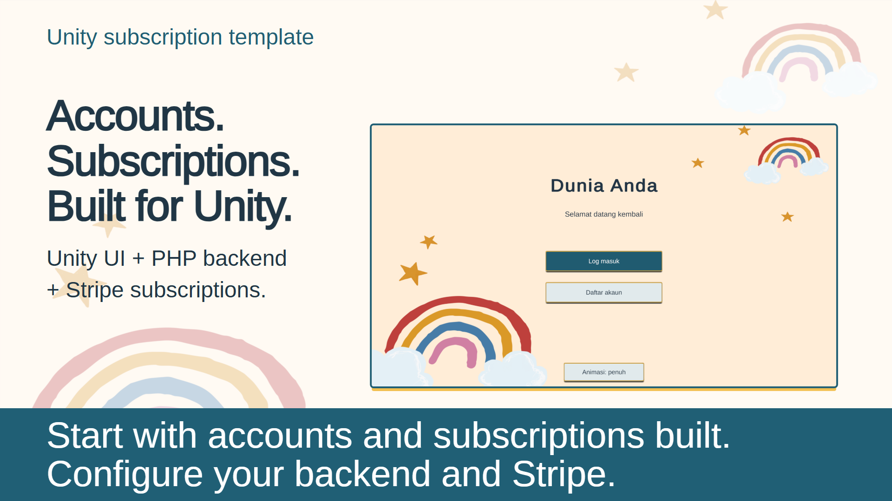

# Unity subscription template

Use the existing LogMasuk and LamanUtama scenes for registration, login, profile and subscription menus. The included PHP backend owns authentication, email verification and Stripe billing; Unity presents its results and gates local premium actions.

Start with [setup](Docs/SETUP.md). It covers offline checks, server preparation, Unity settings and the online test sequence. The backend URL is intentionally empty until configured.

## Trailer

[Watch or download with music](output/video/Subscription_Template_Trailer_60s.mp4) | [SFX-only version](output/video/Subscription_Template_Trailer_60s_NoBGM.mp4) | [Subtitles](output/video/Subscription_Template_Trailer_60s.srt) | [Editable source and rebuild guide](Docs/Trailer60/README.md)

60 seconds | 1920 x 1080 | 30 fps.

## Find what you want to change

| Task | Source or guide |
| --- | --- |
| Configure backend and game key | `Assets/Settings/SubscriptionSettings.asset`; [setup](Docs/SETUP.md#connect-unity) |
| Change menu colors, labels or motion | [Menu customization tutorial](Docs/tutorial/game-ui-customization.md) · [HTML](Docs/tutorial/game-ui-customization.html) · [PDF](Docs/tutorial/game-ui-customization.pdf) |
| Understand account code or adapt validation | [Account customization tutorial](Docs/tutorial/account-flow-customization.md) · [HTML](Docs/tutorial/account-flow-customization.html) · [PDF](Docs/tutorial/account-flow-customization.pdf) |
| Install or operate the server | [Backend reference](Backend/SubscriptionServer/README.md) |
| Inspect request and access rules | [Integration contract](Docs/BACKEND_CONTRACT.md) |
| Check completed validation and limitations | [Verification record](Docs/VERIFICATION.md) |
| Watch or edit the current 60-second trailer | [Video](output/video/Subscription_Template_Trailer_60s.mp4) · [Editing guide](Docs/Trailer60/README.md) |

Open with Unity 2022.3.62f3, as recorded in `ProjectSettings/ProjectVersion.txt`. Keep the original scenes and their component bindings. Colors and durations live in the shared theme; layouts remain editable in the scenes and shared button-face prefab. There is no runtime scene generator.

Sessions are memory-only, so restart requires login. PlayerPrefs holds display caches and UI preferences, not authorization. Premium access requires fresh server state and a future paid-through timestamp. Billing uses authenticated single-use ticket links; a browser redirect cannot grant access.

`Publish/`, the PDF in `output/pdf/` and the older 45-second trailer are historical outputs. Current setup and customization instructions are the Markdown sources linked above. The current trailer's editable source is in `Docs/Trailer60/`; older PDF/trailer sources remain in `Docs/SetupGuide/` and `Docs/Trailer/` with screenshots from before the menu redesign.

## Intended game integration

Use the verified subscription result to unlock selected content in a host Unity game. The player signs in, subscribes through the hosted billing page, and refreshes server status before accessing premium actions. Adapt the sample gate to the host game's content and test the complete payment flow against your configured backend.

The [earlier client validation notes](docs/VALIDATION.md) describe the August 2024 baseline, before the backend and UI updates included here. Use the current [verification record](Docs/VERIFICATION.md) for this version.

## Attribution

GPM is bundled with its [license notice](Assets/GPM/LICENSE.txt). Preserve third-party notices when adapting the project. This repository has no top-level software license; confirm code and asset permissions before redistribution.
